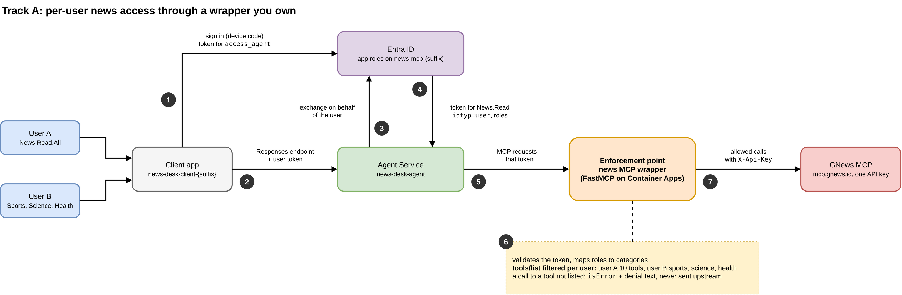
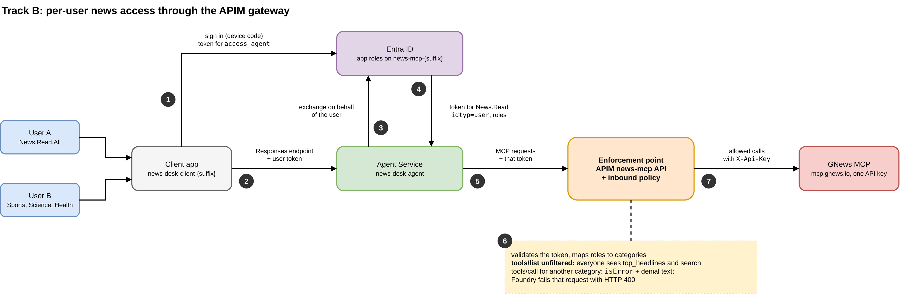

# Per-user access to an MCP server you do not own

One Foundry agent serves several people, and each person may read different things through the same MCP tool. This lab builds that for a news desk. `news-desk-agent` answers headline requests for two users, and the GNews MCP server behind it has one API key and no idea who is asking. Two tracks put an **enforcement point** between the agent and GNews: it reads the user from the token Foundry sends and allows or refuses each call.

| | User A | User B |
|---|---|---|
| Who | the tenant admin who runs the notebooks | `news-sports-desk`, a test user 08-05c-01 creates |
| App roles on `news-mcp-{suffix}` | `News.Read.All` | `News.Read.Sports`, `News.Read.Science`, `News.Read.Health` |
| Business headlines | yes | no |

## Contents

1. [The requirement](#1-the-requirement)
2. [Why the agent and the vendor server cannot enforce it](#2-why-the-agent-and-the-vendor-server-cannot-enforce-it)
3. [Two places to enforce it](#3-two-places-to-enforce-it)
4. [How a request carries the user](#4-how-a-request-carries-the-user)
5. [The per-agent variant](#5-the-per-agent-variant)
6. [Revoking a category](#6-revoking-a-category)
7. [What the live runs showed](#7-what-the-live-runs-showed)
8. [Implementation notes](#8-implementation-notes)
9. [Preview features and fallbacks](#9-preview-features-and-fallbacks)
10. [Run the lab](#10-run-the-lab)
11. [Demo runbook](#11-demo-runbook)
12. [Teardown](#12-teardown)
13. [Research](#13-research)

## 1. The requirement

- A user's news categories are Entra **app roles** on a resource app, `news-mcp-{suffix}`: `News.Read.All` or one `News.Read.<Category>` role per category, for GNews's nine categories (general, world, nation, business, technology, entertainment, sports, science, health).
- The rule applies to the person calling the agent. Both users call the same agent, the same version and the same tool.
- The news comes from a third-party MCP server, GNews at `https://mcp.gnews.io/`. It has two tools, `top_headlines(category, ...)` and `search(q, ...)`, and authenticates with one `X-Api-Key`. You cannot change it.

## 2. Why the agent and the vendor server cannot enforce it

- **`allowed_tools` restricts the agent, not the user.** It is part of the agent definition, the same for every caller. And GNews's `top_headlines` covers all nine categories through an argument, so no list of tool names can separate business from sports.
- **The vendor server knows one key.** Every request with that key may read every category.
- **Instructions are not a control.** The model follows them most of the time; section 7 shows two ways it did not.

So the check sits between Foundry and GNews, where each request carries both the user's identity and the category being asked for.

## 3. Two places to enforce it

| | Track A: a wrapper you own ([08-05c-02](08-05c-02-wrapper-container-app.ipynb)) | Track B: the APIM gateway ([08-05c-03](08-05c-03-apim-passthrough.ipynb)) |
|---|---|---|
| Enforcement point | a FastMCP server, [`news-mcp-wrapper/server.py`](news-mcp-wrapper/server.py), on Container Apps | an inbound policy, [`infra/news-mcp-policy.xml`](infra/news-mcp-policy.xml), on the existing `apim-foundry-{suffix}` |
| Tools the agent sees | one per category plus `search_news`; each user sees only theirs | GNews's own `top_headlines` and `search`, the same for everyone |
| `tools/list` per user | filtered from the token's roles | not filtered: a policy at MCP scope must not read the response body |
| A request outside the user's rights | the tool is not listed, so the agent calls nothing and says the user's access does not cover it | the policy answers the call with `isError: true` and the denial text; Foundry then fails the request with HTTP 400 |
| What the enforcement point logs | every claim and decision, per call | APIM's standard request telemetry |
| Moving parts | an image, a registry, a Container Apps environment, a log workspace | one API, one policy, one backend and one named value on a gateway you already run |
| Pick it when | you want per-user tool lists, a record of who called what, or rules beyond a category check | a gateway already fronts your tools and a check at call time is enough |

Both tracks deny with the same text, which names what the user may read: "Your access covers: sports, science, health. Do not retry other categories."

## 4. How a request carries the user





1. The user signs in to the public client app `news-desk-client-{suffix}` with a device code and gets a token for the agent blueprint's `access_agent` scope.
2. The client calls the agent's Responses endpoint, `{project endpoint}/agents/news-desk-agent/endpoint/protocols/openai?api-version=v1`, with that token. The endpoint's `AgentBlueprint` authorization scheme accepts it.
3. Agent Service asks Entra ID, as the agent's identity, for a token for `api://news-mcp-{suffix}/News.Read` on behalf of the user. The `AgentOnBehalfOfUser` connection on the tool tells it to.
4. Entra ID issues a delegated token that carries the user's app roles.
5. Agent Service sends the MCP requests (`initialize`, `tools/list`, `tools/call`) to the enforcement point with that token.
6. The enforcement point validates the token (signature, issuer, tenant, audience, expiry) and maps `roles` to categories.
7. Allowed calls go to GNews with the `X-Api-Key` the enforcement point holds. The user's token goes no further.

### The token the enforcement point receives

Observed on 2026-10-30, from the wrapper's log in 08-05c-02 Step 5:

| Claim | Value |
|---|---|
| `idtyp` | `user`: a delegated token |
| `oid` | the user's object id |
| `azp` | the client id of `news-desk-agent`'s agent identity, not the blueprint's and not the client app's |
| `roles` | the user's app roles on `news-mcp-{suffix}` |
| `scp` | `News.Read` |
| `aud` | the client id of `news-mcp-{suffix}` (a v2 token) |

Foundry's MCP client calls itself `ToolServer` and speaks protocol `2025-11-25`.

### Consent

The client app carries admin consent (`AllPrincipals` grants) for what the users sign in to: `access_agent` on the blueprint, `News.Read`, and Graph `User.Read`. For the downstream `News.Read` token in step 3, 08-05c-01 Step 8 sets four things:

1. **Preauthorization**: the resource app's `api.preAuthorizedApplications` names the blueprint and the `News.Read` scope.
2. **The blueprint's permissions**: `requiredResourceAccess` declares `News.Read`, and `inheritablePermissions` is meant to pass consented scopes to the blueprint's agent identities.
3. **Admin consent on the blueprint**: an `AllPrincipals` grant for `News.Read`.
4. **Admin consent on the agent identity**: the same grant on `news-desk-agent`'s own service principal.

Learn documents the first three. In this lab's run Foundry kept answering with an `oauth_consent_request` that named the agent identity, and only the fourth removed it.

### A sixth MCP authentication method

The MCP guide ([08-05-00, section 6](../08-05-contoso-pmo-mcp/08-05-00-mcp-guide.md#6-mcp-authentication-methods-in-azure-ai-foundry)) lists the ways a Foundry agent authenticates to an MCP server. This lab adds **Microsoft Entra user delegation**: the connection asks Foundry to exchange the caller's token for one addressed to the server, on the caller's behalf.

```json
{
  "properties": {
    "category": "RemoteTool",
    "target": "https://apim-foundry-{suffix}.azure-api.net/news-mcp/mcp",
    "authType": "AgentOnBehalfOfUser",
    "scopes": ["api://news-mcp-{suffix}/News.Read"],
    "metadata": {"type": "generic_mcp"}
  }
}
```

The published ARM schema lists neither `AgentOnBehalfOfUser` nor `scopes`; ARM accepted this JSON at `2025-04-01-preview`. The agent's endpoint keeps the `AzureRbac` scheme beside `AgentBlueprint`. A Foundry token from `az login` is the signed-in user's own token, and Foundry exchanged it on that user's behalf in the same way (08-05c-02 Step 8), so keeping the scheme opens no way around the per-user rules.

## 5. The per-agent variant

When no test user can be created, or when entitlements belong to agents rather than people, each agent gets its own app roles. 08-05c-02 Step 9 creates `news-all-agent` with `News.Read.All` and `news-sports-agent` with `News.Read.Sports`, assigned to their agent identities. Their connections use `AgenticIdentityToken` with the audience `api://news-mcp-{suffix}`, so the wrapper receives an app-only token: `idtyp=app`, `oid` the agent identity's principal, `azp` its client id, its roles, no user. The wrapper code does not change, and neither do the outcomes: the sports agent asking for business finds no business tool.

## 6. Revoking a category

08-05c-02 Step 10 removes `News.Read.Science` from user B and records the time; 08-05c-03 measures the effect on both tracks.

- **Track B:** `news-mcp-apim` had never fetched a token for user B, so the token Foundry obtained carried the new roles. Science was denied 13 minutes after the revocation.
- **Track A:** Foundry had called the wrapper for user B 3 seconds before the revocation. Thirteen minutes later the wrapper received a token with sports and health only, so science was no longer offered. That held for a user token issued before the revocation too.

A role change applies when Foundry obtains its next downstream token. Entra access tokens can live 60 to 90 minutes, and this run does not show how long Foundry may keep one, so do not count on an immediate effect. For an immediate cut, refuse the user at the enforcement point (for example by `oid`) or block their sign-in.

## 7. What the live runs showed

- **The device code page reuses the browser's account.** Twice the admin account was picked when user B was meant, and the "user B" results were the admin's. Every sign-in cell now prints the account it expects and compares the token's `oid`.
- **The model fills gaps.** With the business tool hidden from user B, one run fetched science headlines instead; another guessed the name `get_business_headlines`, which Foundry rejected with HTTP 400 "Tool get_business_headlines not found on remote server". The instructions now forbid fetching another category, and the checks fail a `substituted` outcome.
- **Foundry fails the request on `isError`.** On Track B the denial reaches the caller as HTTP 400 `tool_user_error`, "An error occurred invoking 'top_headlines': " followed by the denial text. The model never sees it, so an application calling the agent must show that error to the user.
- **Foundry can cache an empty tool list.** While a broken gateway API listed no tools, user A's token kept getting an empty list after the fix, even on a new agent version. A new sign-in cleared it.
- **APIM's MCP pass-through** needs a backend and `backendId` on the API; without them APIM answers `initialize` itself and lists no tools. Clients reach the API at `/mcp` under its path, APIM appends that `/mcp` to the backend URL, and the policy rewrites it back to `/` for GNews. At `2025-09-01-preview` the service rejected `mcpProperties` in the shape the REST spec gives, so the template uses `2024-06-01-preview` like the AI-Gateway samples.
- **The agent endpoint** needs `api-version=v1`, and runs a specific version when the request body carries `agent_reference` with a `version`.
- **GNews** keeps an MCP session per client, returns every language unless asked for one (the instructions ask for `lang en`), and delays articles by 12 hours on the free plan.

## 8. Implementation notes

- **FastMCP is pinned to `>=3.4,<4`** (3.4.11). FastMCP 4 is a new major release. In 3.4.11, `auth=` on a tool hides it from `tools/list` and makes a direct call fail as "Unknown tool", which a model reads as a server fault and retries around. The wrapper's middleware filters `tools/list` and answers any other call with the denial text; `auth=` stays on each tool as a second layer that calls the same predicate.
- **`MCP-Protocol-Version` is logged.** The wrapper records the version Foundry asks for at `initialize` and the header on each `tools/call`, so a change in Foundry's MCP client shows in the logs before it shows as a failure.
- **The wrapper runs stateless** (`stateless_http=True`), so it needs no session affinity across replicas, and keeps one replica warm to avoid a cold start inside Foundry's 100-second tool timeout.
- **The policy reads the request body** with `preserveContent: true` and never the response body. Allowed calls returned articles, so the body still reached GNews.

## 9. Preview features and fallbacks

User delegation (`AgentOnBehalfOfUser`), the `AgentBlueprint` endpoint scheme and agent identities are in preview. Shapes and behaviour may change; the notebooks record what they saw, with dates.

### If the connection API refuses

08-05c-01 Step 10 tries the Learn JSON at three ARM api-versions, then `AgentUserImpersonation`, and keeps the first one ARM accepts. If none is accepted, two routes remain:

- **OAuth identity passthrough** (`OAuth2` connection). Each user follows an `oauth_consent_request` link once. The server sees the user but not the agent, and the connection holds the OAuth client's settings.
- **The per-agent variant** (section 5), with entitlements on agents instead of users.

### If the token carries no roles

The wrapper reads `NEWS_MCP_OID_ROLES`, a JSON map from `oid` to app roles, and uses it when a token has no `roles` claim. Build it from the Graph assignments on `news-mcp-{suffix}` and set it on the container app.

## 10. Run the lab

**Prerequisites**

1. `uv sync` from the repository root, and the `.venv` kernel.
2. [05-02](../../05-foundry-project-pattern-setup/05-02-deploy-foundry-core-gateway/05-02-01-deploy-foundry-core-gateway.ipynb) deployed `aif-core-{suffix}`, `project-admin-{suffix}` and `apim-foundry-{suffix}`.
3. `az login` as a **Global Administrator** of a tenant you are allowed to change. 08-05c-01 registers two apps, creates a user, grants tenant-wide consent and may turn on the Temporary Access Pass method.
4. A free GNews key from [gnews.io](https://gnews.io) (100 requests a day) as `GNEWS_API_KEY` in `.env`. A full run makes about 10 GNews requests; denied calls make none.
5. A private browser window for user B's sign-ins.

**Notebooks, in order**

| Notebook | What it does |
|---|---|
| [08-05c-01](08-05c-01-identity-and-agent.ipynb) | Apps, user B and their pass, the agent and its endpoint, consent, app roles, the `news-mcp-apim` connection |
| [08-05c-02](08-05c-02-wrapper-container-app.ipynb) | Track A: deploys the wrapper, runs the matrix, the per-agent variant, and revokes `News.Read.Science` |
| [08-05c-03](08-05c-03-apim-passthrough.ipynb) | Track B: adds the MCP API to the gateway, runs the matrix, and checks whether the revocation reached Track A |

Run 08-05c-03 within the hour after 08-05c-02, so its last step measures a short delay.

**Sign-ins.** Each notebook signs in both users with a device code: the cell prints a code, you enter it at the address it prints, and the cell stops if the token belongs to someone else.

| User | Account | Method |
|---|---|---|
| A | your admin account, the one `az login` uses | your usual password and multifactor method |
| B | `news-sports-desk@{your tenant's default domain}`, in `.env` as `NEWS_TEST_USER_UPN` | Temporary Access Pass, in `.env` as `NEWS_TEST_USER_TAP` |

For user B, use a private window, choose **Use another account**, type user B's account, and when Entra asks for a password choose **Other ways to sign in**, then **Temporary Access Pass**. `grep -E 'NEWS_TEST_USER_(UPN|TAP)' .env` shows both values. In this lab's runs Entra asked user B for nothing beyond the pass, not even security-info registration. The pass lasts 8 hours; re-run Step 5 of 08-05c-01 for a new one.

**`.env` keys.** You set `GNEWS_API_KEY`, and optionally `NEWS_MCP_RESOURCE_GROUP`, `NEWS_MCP_LOCATION` and `NEWS_TEST_USER_UPN` (see `.env.example`). 08-05c-01 writes `NEWS_MCP_RESOURCE_APP_ID`, `NEWS_MCP_RESOURCE_SP_ID`, `NEWS_DESK_CLIENT_APP_ID`, `NEWS_TEST_USER_UPN`, `NEWS_TEST_USER_ID`, `NEWS_TEST_USER_TAP`, `NEWS_AGENT_BLUEPRINT_CLIENT_ID`, `NEWS_CONNECTION_AUTH_TYPE` and `NEWS_CONNECTION_API_VERSION`; 08-05c-02 writes `NEWS_MCP_WRAPPER_URL` and `NEWS_SCIENCE_REVOKED_AT`.

## 11. Demo runbook

A demo of both tracks follows the notebooks in order, because 08-05c-02 ends by revoking user B's science role and 08-05c-03 shows what that revocation does. Plan for under an hour from an empty tenant to the end of Track B, with six device code sign-ins: user A and user B in each notebook.

### Before the day

- 05-02's gateway is deployed, `az login` works as a Global Administrator, and `GNEWS_API_KEY` is in `.env`.
- The GNews free plan allows 100 requests a day and delays articles by 12 hours. Building and demoing both tracks uses about 20 requests; each question that returns articles uses one more.
- The pass for user B lasts 8 hours, so create it on the day: 08-05c-01 Step 5 does that.

### The run

| Part | What to run | What to show |
|---|---|---|
| Identity | 08-05c-01, all of it | the two users and their app roles (Step 9), the agent's endpoint schemes (Step 7), the user B sign-in with `amr` `tap, mfa` (Step 6), each user calling the agent (Step 11) |
| Track A | 08-05c-02 Steps 1 to 9; stop before Step 10 | the token the wrapper received (Step 5), the matrix (Step 6), your own questions, the tool lists (Step 7), the per-agent variant (Step 9) |
| Revocation | 08-05c-02 Step 10 | user B now holds sports and health |
| Track B | 08-05c-03, all of it | the API added to the gateway and the 401 without a token (Steps 1 and 2), the matrix (Step 4), your own questions, the denial at the gateway (Step 5), Track A after the revocation (Step 6) |

The Container Apps deployment in 08-05c-02 takes about 6 minutes (environment, image build, app); the gateway deployment in 08-05c-03 takes under a minute.

### Test cases and what to expect

The model words its replies differently each time. What to check is which tools the agent listed and called, and whether articles or a denial came back; the notebooks print both.

| # | Where | User | Request | Expected |
|---|---|---|---|---|
| 1 | Track A | A | Give me three business headlines | ten tools listed; `get_business_headlines` called; three business headlines |
| 2 | Track A | B | Give me three business headlines | three tools listed (sports, science, health); no call; a reply that user B's access does not include business |
| 3 | Track A | B | Give me three sports headlines | `get_sports_headlines` called; three sports headlines |
| 4 | Track A, before Step 10 | B | Give me three science headlines | `get_science_headlines` called; three science headlines |
| 5 | Track A, Step 7 | B | direct `tools/call` of `get_business_headlines` | `isError=True` and "Your access covers: sports, science, health. Do not retry other categories."; the wrapper logs `denied` and makes no upstream call |
| 6 | Track A, Step 9 | `news-sports-agent` | Give me three business headlines | no call; the wrapper's log shows `idtyp=app` for the calls the agents did make |
| 7 | Track B | A | Give me three business headlines | `search` and `top_headlines` listed; `top_headlines` called with `category: business`; three business headlines |
| 8 | Track B | B | Give me three business headlines | HTTP 400 from the agent endpoint: "An error occurred invoking 'top_headlines': Your access covers: sports, health. Do not retry other categories." |
| 9 | Track B | B | Give me three sports headlines | `top_headlines` called with `category: sports`; three sports headlines |
| 10 | Track B, after Step 10 | B | Give me three science headlines | HTTP 400 with the same denial text |
| 11 | Track B, Step 6 | B | Give me three science headlines, on the Track A version | no science tool listed and no call; Foundry may still hold a token from before the revocation, in which case science headlines come back |
| 12 | Track B | B | Search for news about the Champions League | HTTP 400 with the denial text: `search` needs `News.Read.All` |

After 08-05c-02 Step 10 the denial text for user B names only sports and health.

### Your own questions

08-05c-02 and 08-05c-03 each have a "Your own questions" cell after the matrix. Set `USER` to `'A'` or `'B'` and `QUESTION` to anything, and run it; it prints the tools the agent listed, the calls it made and the reply, or the HTTP 400 that Foundry returns when the gateway denies a call. Questions that show the difference between the tracks:

- `What news tools do you have?` as A, then as B: ten tools and three on Track A, the same two for both on Track B.
- `Give me three business headlines` as B: a polite refusal on Track A, an HTTP 400 on Track B.

### If something goes wrong

- **A sign-in cell stops with "That sign-in was not user B":** the browser offered the account it already had. Re-run the cell, open a private window, and choose **Use another account**.
- **The pass has expired:** re-run 08-05c-01 Step 5 for a new one, then sign user B in again.
- **A user's agent lists no tools after a fix to the server or gateway:** Foundry may still serve that user's earlier, empty list. Sign the user in again.

### Running it twice

The simplest way is the teardown in section 12 and a fresh build. To repeat the revocation without one, give user B the science role back by re-running 08-05c-01 Step 9, which adds any assignment that is missing. The agent endpoint runs the agent's latest version, which after 08-05c-03 is the Track B one: 08-05c-02's cells then test Track B, and its notebook needs a new Track A version before its matrix means anything.

## 12. Teardown

The Cleanup section of [08-05c-01](08-05c-01-identity-and-agent.ipynb) removes everything the lab created, in order: the three agents and their agent identities, the four connections, the MCP API, backend and named value on the gateway, the Track A resource group, user B, and both app registrations with their service principals, consent grants and role assignments. Users and apps are then purged from the Entra recycle bin, and the lab's keys are removed from `.env`. 08-05c-02 and 08-05c-03 each have a smaller cleanup cell for their own track.

The Temporary Access Pass method stays on: whether it is on is a tenant setting, and it may have been on before. The cleanup cell ends with a commented line that turns it off.

## 13. Research

The research behind the design, with sources: [docs/research/08-05c-mcp-access-control/](../../docs/research/08-05c-mcp-access-control/README.md).
