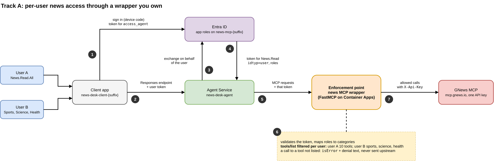
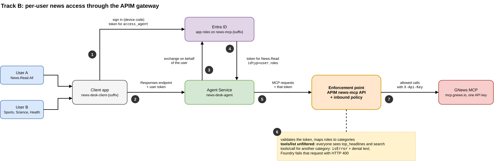

# Per-user access to an MCP server you do not own

One Foundry agent serves several people, and each person may read different things through the same MCP tool. This lab builds that for a news desk. `news-desk-agent` answers headline requests for two users, and the GNews MCP server behind it has one API key and no idea who is asking. Two tracks put an **enforcement point** between the agent and GNews: it reads the user from the token Foundry sends and allows or refuses each call.

| | User A | User B |
|---|---|---|
| Who | the tenant admin who runs the notebooks | `news-sports-desk`, a test user 08-05c-01 creates |
| App roles on `news-mcp-{suffix}` | `News.Read.All` | `News.Read.Sports`, `News.Read.Science`, `News.Read.Health` |
| Business headlines | yes | no |

## Contents

1. [The requirement](#1-the-requirement)
2. [Why the agent and the vendor server cannot enforce it](#2-why-the-agent-and-the-vendor-server-cannot-enforce-it)
3. [Two places to enforce it](#3-two-places-to-enforce-it)
4. [How a request carries the user](#4-how-a-request-carries-the-user)
5. [Revoking a category](#5-revoking-a-category)
6. [What the live runs showed](#6-what-the-live-runs-showed)
7. [Implementation notes](#7-implementation-notes)
8. [Preview features and fallbacks](#8-preview-features-and-fallbacks)
9. [Run the lab](#9-run-the-lab)
10. [Demo runbook](#10-demo-runbook)
11. [Teardown](#11-teardown)
12. [Research](#12-research)

## 1. The requirement

- A user's news categories are Entra **app roles** on a resource app, `news-mcp-{suffix}`: `News.Read.All` or one `News.Read.<Category>` role per category, for GNews's nine categories (general, world, nation, business, technology, entertainment, sports, science, health).
- The rule applies to the person calling the agent. Both users call the same agent, the same version and the same tool.
- The news comes from a third-party MCP server, GNews at `https://mcp.gnews.io/`. It has two tools, `top_headlines(category, ...)` and `search(q, ...)`, and authenticates with one `X-Api-Key`. You cannot change it.

## 2. Why the agent and the vendor server cannot enforce it

- **`allowed_tools` restricts the agent, not the user.** It is part of the agent definition, the same for every caller. And GNews's `top_headlines` covers all nine categories through an argument, so no list of tool names can separate business from sports.
- **The vendor server knows one key.** Every request with that key may read every category.
- **Instructions are not a control.** The model follows them most of the time; section 6 shows two ways it did not.

So the check sits between Foundry and GNews, where each request carries both the user's identity and the category being asked for.

## 3. Two places to enforce it

| | Track A: a wrapper you own ([08-05c-02](08-05c-02-wrapper-container-app.ipynb)) | Track B: the APIM gateway ([08-05c-03](08-05c-03-apim-passthrough.ipynb)) |
|---|---|---|
| Enforcement point | a FastMCP server, [`news-mcp-wrapper/server.py`](news-mcp-wrapper/server.py), on Container Apps | an inbound policy, [`infra/news-mcp-policy.xml`](infra/news-mcp-policy.xml), on the existing `apim-foundry-{suffix}` |
| Tools the agent sees | one per category plus `search_news`; each user sees only theirs | GNews's own `top_headlines` and `search`, the same for everyone |
| `tools/list` per user | filtered from the token's roles | not filtered: a policy at MCP scope must not read the response body |
| A request outside the user's rights | the tool is not listed, so the agent calls nothing and says the user's access does not cover it | the policy answers the call with `isError: true` and the denial text; Foundry then fails the request with HTTP 400 |
| What the enforcement point logs | every claim and decision, per call | APIM's standard request telemetry |
| Moving parts | an image, a registry, a Container Apps environment, a log workspace | one API, one policy, one backend and one named value on a gateway you already run |
| Pick it when | you want per-user tool lists, a record of who called what, or rules beyond a category check | a gateway already fronts your tools and a check at call time is enough |

Both tracks deny with the same text, which names what the user may read: "Your access covers: sports, science, health. Do not retry other categories."

## 4. How a request carries the user





1. The user signs in to the public client app `news-desk-client-{suffix}` with a device code and gets a token for the agent blueprint's `access_agent` scope. Foundry adds that delegated scope to the blueprint when the endpoint gets the `AgentBlueprint` scheme (08-05c-01 Step 7). A token for it lets an app call this one agent as the signed-in user.
2. The client calls the agent's Responses endpoint, `{project endpoint}/agents/news-desk-agent/endpoint/protocols/openai?api-version=v1`, with that token. The endpoint's `AgentBlueprint` authorization scheme accepts it: the token is for this agent's blueprint, and Entra issued it to `news-desk-client`, the one app in the scheme's `allowed_clients`.
3. Agent Service exchanges that token with Entra ID, as the agent's identity, for a token for `api://news-mcp-{suffix}/News.Read` on behalf of the user. The `AgentOnBehalfOfUser` connection on the tool tells it to. [The on-behalf-of exchange](#the-on-behalf-of-exchange) below explains how.
4. Entra ID issues a delegated token that carries the user's app roles as they are at that moment.
5. Agent Service sends the MCP requests (`initialize`, `tools/list`, `tools/call`) to the enforcement point with that token.
6. The enforcement point validates the token and maps `roles` to categories. The token is a JWT, a set of claims signed by Entra ID: the enforcement point checks the signature with the tenant's published signing keys, then the issuer, tenant, audience and expiry, requires the `News.Read` scope, and reads the claims.
7. Allowed calls go to GNews with the `X-Api-Key` the enforcement point holds. The user's token goes no further.

### The on-behalf-of exchange

Steps 3 and 4 are the OAuth 2.0 on-behalf-of (OBO) flow. Agent Service trades the token the user sent for a new one addressed to the news server, still about the same user.

**Why Foundry exchanges the token**

- **The user's token is for the agent.** Its audience is the agent blueprint, so the news server would reject it, and a server that received it could replay it against the agent.
- **The agent's own token is the same for every caller.** An app-only token names the agent, not the user, so the server could not tell user A from user B.
- **The exchanged token names both.** It carries the user (`oid`, `roles`) and the agent acting for them (`azp`), and it is valid for one API and one scope.

**How it works**

Microsoft Entra Agent ID documents the protocol; this lab observed only the tokens at each end.

1. **Agent Service signs in as the agent.** An agent identity has no credential of its own. Agent Service presents the blueprint's federated credential, which Foundry provisions and which Foundry projects, agent code and the project managed identity never hold, and Entra issues a token for the agent identity ([agent identity in Foundry](https://learn.microsoft.com/en-us/azure/foundry/agents/concepts/agent-identity), [the Entra protocol](https://learn.microsoft.com/en-us/entra/agent-id/agent-autonomous-app-oauth-flow)).
2. **It sends the on-behalf-of request.** A `jwt-bearer` grant to Entra's token endpoint: the user's token as the `assertion`, the agent identity as the client with the token from step 1 as its `client_assertion`, and `api://news-mcp-{suffix}/News.Read` as the scope ([on-behalf-of with an agent identity](https://learn.microsoft.com/en-us/entra/agent-id/sidecar-local-development)).
3. **Entra checks** the user's token, and that the agent identity may act for users on `News.Read`: the four settings under [Consent](#consent) below. Conditional Access for an on-behalf-of request targets the user ([Conditional Access for agents](https://learn.microsoft.com/en-us/entra/identity/conditional-access/agent-id)).
4. **Entra issues the token** with the user's app role assignments, as they are now, in `roles`.
5. **Agent Service reuses the token** for later MCP requests until it expires, so a role change applies at the next exchange. [Section 5](#5-revoking-a-category) measures how long that took.

### The token the enforcement point receives

The right-hand column was observed on 2026-10-30 in the wrapper's log (08-05c-02 Step 5). The notebooks do not decode the user's token, so the left-hand column gives what the [access token claims reference](https://learn.microsoft.com/en-us/entra/identity-platform/access-token-claims-reference) defines for a token the user gets through `news-desk-client`.

| Claim | The user's token, to the agent (steps 1 and 2) | The exchanged token, to the enforcement point (steps 3 to 5) |
|---|---|---|
| `aud` | the agent blueprint | the client id of `news-mcp-{suffix}` (a v2 token) |
| `scp` | `access_agent` | `News.Read` |
| `azp` (`appid` in a v1 token) | the client id of `news-desk-client-{suffix}` | the client id of `news-desk-agent`'s agent identity, not the blueprint's and not the client app's |
| `oid` | the user's object id | the user's object id, the same |
| `roles` | none: the lab assigns no app roles on the blueprint | the user's app roles on `news-mcp-{suffix}` |
| `idtyp` | not recorded | `user`: a delegated token |

Foundry's MCP client calls itself `ToolServer` and speaks protocol `2025-11-25`.

### Client app and resource app, in plain terms

**`news-desk-client` stands in for the real application.** The lab has no app UI, so the notebook plays that part. The notebooks' sign-in cells call `checks.user_credential(TENANT_ID, CLIENT_APP_ID, device_code=True)`, which becomes `DeviceCodeCredential(client_id=...)` in [`news_mcp_checks.py`](news_mcp_checks.py). At that moment the notebook is signing the user in *as* `news-desk-client`. In production it would be a news-desk web app, a Teams app or a mobile app.

`news-mcp` isn't something anyone signs into. It is Entra's record of the news service and its permission levels.

#### Every token names a "from" and a "to"

A token Entra issues works like a ticket. It says:

- **who** the person is (`oid`)
- **which app** they used to get it (`azp`): this is the **client**
- **where** the ticket is valid (`aud`): this is the **resource**
- **what** they may do there (`scp`, `roles`)

So Entra needs both ends registered: the app doing the asking, and the thing being asked. Those are the two apps.

#### A real-world example

Outlook is a client. Exchange (through Microsoft Graph) is the resource. Your mailbox rights belong to Exchange, not to Outlook. That's why Outlook on your phone, Outlook on the web and Thunderbird all see the same mailbox with the same rights.

| | Real world | This lab |
|---|---|---|
| Client: the app the person opens | Outlook | `news-desk-client` (the notebook, in place of a real app) |
| Resource: owns the data and the rules | Exchange / Graph | `news-mcp` (rules = the `News.Read.*` roles) |
| The program that checks the ticket | Exchange's servers | the wrapper (Track A) or the APIM policy (Track B) |

`news-mcp` has no code of its own. It is an entry in Entra that says "a news API exists, these are its permission levels, and this is who holds which". The wrapper and the APIM policy are the programs that read tokens addressed to it. GNews never sees any of this.

#### Why two apps and not one

1. **Rights belong to what you access, not to what you access it with.** "User B may read sports" is a fact about the news service. Add a Teams bot later as a second client and user B is still sports-only there, with no changes, because the rule is stored on `news-mcp`.
2. **The news server only accepts tickets addressed to itself.** The wrapper and the policy check that `aud` is `news-mcp`'s id. Tokens can only be addressed to it because it exists as an app.
3. **The client app decides which apps may call the agent.** The agent endpoint's `allowed_clients` lists only `news-desk-client`. That is a rule about which front-end apps are allowed, and it is separate from the news permissions.

#### Where the agent fits: "client" and "resource" are roles in each hop

The request makes two hops, and the agent plays a different role in each:

```
 User B
   | signs in through news-desk-client (the notebook)
   v
 Hop 1: ticket from news-desk-client  ->  to the agent     scp: access_agent
   |
   | Foundry trades the ticket in (on-behalf-of)
   v
 Hop 2: ticket from the agent  ->  to news-mcp            scp: News.Read
                                                           roles: B's categories
   v
 wrapper / APIM checks the ticket, then calls GNews with the one API key
```

In hop 1, `news-desk-client` is the client and the agent is the resource. In hop 2, the agent is the client and `news-mcp` is the resource. That's what the next subsection means by "resource app is not a third object": "resource" describes the role an app plays in one hop, not a kind of app. The user (`oid`) stays the same on both tickets. Only "from" and "to" change. Entra fills in `roles` from `news-mcp`'s assignments at the moment of the trade.

#### App registration vs enterprise app

Each app is stored in Entra as two parts:

- **App registration**: the definition. For `news-mcp` it lists the permission levels that exist (`News.Read.All`, `News.Read.Sports`, ...). Think of it as the menu.
- **Enterprise app**: the app's copy in your tenant, where tenant-specific facts live. For `news-mcp` it records that user A holds All and user B holds sports, science and health. Think of it as the guest list.

The split exists because an app is defined once but can be used in many tenants. Slack's registration lives in Slack's tenant. Your tenant has an enterprise app for Slack that records who in your company is assigned to it and what your admin consented to. In this lab both parts are in the same tenant, so they look like duplicates.

What this means in the portal:

- To see which roles **exist**: App registrations > `news-mcp-{suffix}` > App roles.
- To see who **holds** them: Enterprise applications > `news-mcp-{suffix}` > Users and groups. You have to clear the Application type filter, or the portal hides the app.

For `news-desk-client`, the registration says "I'm a public client with no secret, and I ask for `access_agent`, `News.Read` and `User.Read`". The enterprise app stores the admin's approval of those permissions, so users never see a consent prompt.

### App registrations and enterprise apps

Entra keeps two objects for an app. The **app registration** (application object) is the app's definition: its app id, the scopes and app roles it exposes, the permissions it asks for, redirect URIs and credentials. The **enterprise app** (service principal) is the app's presence in a tenant: who holds which app role, admin consent grants, sign-in logs. "Resource app" is not a third object; it names an app that exposes an API other apps get tokens for.

- **`news-mcp-{suffix}`, the resource app.**
  - Its app registration defines the `News.Read` scope and the ten `News.Read.*` roles (the **App roles** and **Expose an API** pages).
  - Its enterprise app holds the role assignments: user A has `News.Read.All`, user B has sports, science and health. 08-05c-01 Step 9 posts them to that service principal (`/servicePrincipals/{id}/appRoleAssignedTo`).
  - So the assignments are under **Enterprise applications** > `news-mcp-{suffix}` > **Users and groups**, not on a user's **Assigned roles** page, which lists directory roles. The default Enterprise applications filter hides the app, because the notebook creates its service principal through Graph without the `WindowsAzureActiveDirectoryIntegratedApp` tag: clear the **Application type** filter, or open the app registration's **Managed application in local directory** link.
  - When Entra issues a token for `news-mcp-{suffix}`, it sets `aud` to the app registration's client id and fills `roles` from the enterprise app's assignments.
- **`news-desk-client-{suffix}`, the client app.**
  - Its app registration says what it is (a public client with no secret) and which permissions it asks for (`access_agent`, `News.Read`, Graph).
  - Its enterprise app holds the admin consent that lets users sign in without a consent prompt.
- **The agent.**
  - The blueprint has both objects: an application of type `agentIdentityBlueprint`, which defines `access_agent`, and its own service principal.
  - The agent identity is a service principal only. It has no app registration and no credential; the blueprint signs in for it. Its `News.Read` consent grant (08-05c-01 Step 8) sits on that service principal.

### Consent

The client app carries admin consent (`AllPrincipals` grants) for what the users sign in to: `access_agent` on the blueprint, `News.Read`, and Graph `User.Read`. For the downstream `News.Read` token in step 3, 08-05c-01 Step 8 sets four things:

1. **Preauthorization**: the resource app's `api.preAuthorizedApplications` names the blueprint and the `News.Read` scope.
2. **The blueprint's permissions**: `requiredResourceAccess` declares `News.Read`, and `inheritablePermissions` is meant to pass consented scopes to the blueprint's agent identities.
3. **Admin consent on the blueprint**: an `AllPrincipals` grant for `News.Read`.
4. **Admin consent on the agent identity**: the same grant on `news-desk-agent`'s own service principal.

Learn documents the first three. In this lab's run Foundry kept answering with an `oauth_consent_request` that named the agent identity, and only the fourth removed it.

### A sixth MCP authentication method

The MCP guide ([08-05-00, section 6](../08-05-contoso-pmo-mcp/08-05-00-mcp-guide.md#6-mcp-authentication-methods-in-azure-ai-foundry)) lists the ways a Foundry agent authenticates to an MCP server. This lab adds **Microsoft Entra user delegation**: the connection asks Foundry to exchange the caller's token for one addressed to the server, on the caller's behalf.

```json
{
  "properties": {
    "category": "RemoteTool",
    "target": "https://apim-foundry-{suffix}.azure-api.net/news-mcp/mcp",
    "authType": "AgentOnBehalfOfUser",
    "scopes": ["api://news-mcp-{suffix}/News.Read"],
    "metadata": {"type": "generic_mcp"}
  }
}
```

The published ARM schema lists neither `AgentOnBehalfOfUser` nor `scopes`; ARM accepted this JSON at `2025-04-01-preview`. The agent's endpoint keeps the `AzureRbac` scheme beside `AgentBlueprint`. A Foundry token from `az login` is the signed-in user's own token. On 2026-10-30 Foundry exchanged it on that user's behalf in the same way, and the wrapper applied that user's roles; on 2026-11-06 the same call failed before Foundry obtained any token for the news server. Either way, keeping the scheme opens no way around the per-user rules.

## 5. Revoking a category

08-05c-02 Step 8 removes `News.Read.Science` from user B and records the time; 08-05c-03 measures the effect on both tracks.

- **Track B:** `news-mcp-apim` had never fetched a token for user B, so the token Foundry obtained carried the new roles. Science was denied 13 minutes after the revocation.
- **Track A:** Foundry had called the wrapper for user B 3 seconds before the revocation. Thirteen minutes later the wrapper received a token with sports and health only, so science was no longer offered. That held for a user token issued before the revocation too.

A role change applies when Foundry obtains its next downstream token. Entra access tokens can live 60 to 90 minutes, and this run does not show how long Foundry may keep one, so do not count on an immediate effect. For an immediate cut, refuse the user at the enforcement point (for example by `oid`) or block their sign-in.

## 6. What the live runs showed

- **The device code page reuses the browser's account.** Twice the admin account was picked when user B was meant, and the "user B" results were the admin's. Every sign-in cell now prints the account it expects and compares the token's `oid`.
- **The model fills gaps.** With the business tool hidden from user B, one run fetched science headlines instead; another guessed the name `get_business_headlines`, which Foundry rejected with HTTP 400 "Tool get_business_headlines not found on remote server". The instructions now forbid fetching another category, and the checks fail a `substituted` outcome.
- **Foundry fails the request on `isError`.** On Track B the denial reaches the caller as HTTP 400 `tool_user_error`, "An error occurred invoking 'top_headlines': " followed by the denial text. The model never sees it, so an application calling the agent must show that error to the user.
- **Foundry can cache an empty tool list.** While a broken gateway API listed no tools, user A's token kept getting an empty list after the fix, even on a new agent version. A new sign-in cleared it.
- **APIM's MCP pass-through** needs a backend and `backendId` on the API; without them APIM answers `initialize` itself and lists no tools. Clients reach the API at `/mcp` under its path, APIM appends that `/mcp` to the backend URL, and the policy rewrites it back to `/` for GNews. At `2025-09-01-preview` the service rejected `mcpProperties` in the shape the REST spec gives, so the template uses `2024-06-01-preview` like the AI-Gateway samples.
- **The agent endpoint** needs `api-version=v1`, and runs a specific version when the request body carries `agent_reference` with a `version`.
- **GNews** keeps an MCP session per client, returns every language unless asked for one (the instructions ask for `lang en`), and delays articles by 12 hours on the free plan.

## 7. Implementation notes

- **FastMCP is pinned to `>=3.4,<4`** (3.4.11). FastMCP 4 is a new major release. In 3.4.11, `auth=` on a tool hides it from `tools/list` and makes a direct call fail as "Unknown tool", which a model reads as a server fault and retries around. The wrapper's middleware filters `tools/list` and answers any other call with the denial text; `auth=` stays on each tool as a second layer that calls the same predicate.
- **`MCP-Protocol-Version` is logged.** The wrapper records the version Foundry asks for at `initialize` and the header on each `tools/call`, so a change in Foundry's MCP client shows in the logs before it shows as a failure.
- **The wrapper runs stateless** (`stateless_http=True`), so it needs no session affinity across replicas, and keeps one replica warm to avoid a cold start inside Foundry's 100-second tool timeout.
- **The policy reads the request body** with `preserveContent: true` and never the response body. Allowed calls returned articles, so the body still reached GNews.
- **Both enforcement points require the `News.Read` scope.** Any app in the tenant that has a credential can get an app-only token for `news-mcp-{suffix}`: its enterprise app does not require assignment, so Entra issues the token, with no `scp` and no `roles`. Without the scope check both tracks accepted such a token and denied every call only because it held no role (observed 2026-11-06). The wrapper's `required_scopes` and the policy's `required-claims` on `scp` refuse it with 401, so only a delegated user token gets in.

## 8. Preview features and fallbacks

User delegation (`AgentOnBehalfOfUser`), the `AgentBlueprint` endpoint scheme and agent identities are in preview. Shapes and behaviour may change; the notebooks record what they saw, with dates.

### If the connection API refuses

08-05c-01 Step 10 tries the Learn JSON at three ARM api-versions, then `AgentUserImpersonation`, and keeps the first one ARM accepts. If none is accepted, one route remains:

- **OAuth identity passthrough** (`OAuth2` connection). Each user follows an `oauth_consent_request` link once. The server sees the user but not the agent, and the connection holds the OAuth client's settings.

### If the token carries no roles

The wrapper reads `NEWS_MCP_OID_ROLES`, a JSON map from `oid` to app roles, and uses it when a token has no `roles` claim. Build it from the Graph assignments on `news-mcp-{suffix}` and set it on the container app.

## 9. Run the lab

**Prerequisites**

1. `uv sync` from the repository root, and the `.venv` kernel.
2. [05-02](../../05-foundry-project-pattern-setup/05-02-deploy-foundry-core-gateway/05-02-01-deploy-foundry-core-gateway.ipynb) deployed `aif-core-{suffix}`, `project-admin-{suffix}` and `apim-foundry-{suffix}`.
3. `az login` as a **Global Administrator** of a tenant you are allowed to change. 08-05c-01 registers two apps, creates a user, grants tenant-wide consent and may turn on the Temporary Access Pass method.
4. A free GNews key from [gnews.io](https://gnews.io) (100 requests a day) as `GNEWS_API_KEY` in `.env`. A full run makes about 7 GNews requests; denied calls make none.
5. A private browser window for user B's sign-ins.

**Notebooks, in order**

| Notebook | What it does |
|---|---|
| [08-05c-01](08-05c-01-identity-and-agent.ipynb) | Apps, user B and their pass, the agent and its endpoint, consent, app roles, the `news-mcp-apim` connection |
| [08-05c-02](08-05c-02-wrapper-container-app.ipynb) | Track A: deploys the wrapper, runs the matrix, and revokes `News.Read.Science` |
| [08-05c-03](08-05c-03-apim-passthrough.ipynb) | Track B: adds the MCP API to the gateway, runs the matrix, and checks whether the revocation reached Track A |
| [08-05c-04](08-05c-04-reset-for-another-run.ipynb) | Optional, after 08-05c-03: gives user B the science role back, and a new pass if needed, for another run of 08-05c-02 and 08-05c-03 |

Run 08-05c-03 within the hour after 08-05c-02, so its last step measures a short delay.

**Sign-ins.** Each notebook signs in both users with a device code: the cell prints a code, you enter it at the address it prints, and the cell stops if the token belongs to someone else.

| User | Account | Method |
|---|---|---|
| A | your admin account, the one `az login` uses | your usual password and multifactor method |
| B | `news-sports-desk@{your tenant's default domain}`, in `.env` as `NEWS_TEST_USER_UPN` | Temporary Access Pass, in `.env` as `NEWS_TEST_USER_TAP` |

For user B, use a private window, choose **Use another account**, type user B's account, and when Entra asks for a password choose **Other ways to sign in**, then **Temporary Access Pass**. `grep -E 'NEWS_TEST_USER_(UPN|TAP)' .env` shows both values. In this lab's runs Entra asked user B for nothing beyond the pass, not even security-info registration. The pass lasts 8 hours; re-run Step 5 of 08-05c-01 for a new one.

**`.env` keys.** You set `GNEWS_API_KEY`, and optionally `NEWS_MCP_RESOURCE_GROUP`, `NEWS_MCP_LOCATION` and `NEWS_TEST_USER_UPN` (see `.env.example`). 08-05c-01 writes `NEWS_MCP_RESOURCE_APP_ID`, `NEWS_MCP_RESOURCE_SP_ID`, `NEWS_DESK_CLIENT_APP_ID`, `NEWS_TEST_USER_UPN`, `NEWS_TEST_USER_ID`, `NEWS_TEST_USER_TAP`, `NEWS_AGENT_BLUEPRINT_CLIENT_ID`, `NEWS_CONNECTION_AUTH_TYPE` and `NEWS_CONNECTION_API_VERSION`; 08-05c-02 writes `NEWS_MCP_WRAPPER_URL` and `NEWS_SCIENCE_REVOKED_AT`.

## 10. Demo runbook

A demo of both tracks follows the notebooks in order, because 08-05c-02 ends by revoking user B's science role and 08-05c-03 shows what that revocation does. Plan for under an hour from an empty tenant to the end of Track B, with six device code sign-ins: user A and user B in each notebook.

### Before the day

- 05-02's gateway is deployed, `az login` works as a Global Administrator, and `GNEWS_API_KEY` is in `.env`.
- The GNews free plan allows 100 requests a day and delays articles by 12 hours. Building and demoing both tracks uses about 20 requests; each question that returns articles uses one more.
- The pass for user B lasts 8 hours, so create it on the day: 08-05c-01 Step 5 does that.

### The run

| Part | What to run | What to show |
|---|---|---|
| Identity | 08-05c-01, all of it | the two users and their app roles (Step 9), the agent's endpoint schemes (Step 7), the user B sign-in with `amr` `tap, mfa` (Step 6), each user calling the agent (Step 11) |
| Track A | 08-05c-02 Steps 1 to 7; stop before Step 8 | the token the wrapper received (Step 5), the matrix (Step 6), your own questions, the tool lists (Step 7) |
| Revocation | 08-05c-02 Step 8 | user B now holds sports and health |
| Track B | 08-05c-03, all of it | the API added to the gateway and the 401 without a token (Steps 1 and 2), the matrix (Step 4), your own questions, the denial at the gateway (Step 5), Track A after the revocation (Step 6) |

The Container Apps deployment in 08-05c-02 takes about 6 minutes (environment, image build, app); the gateway deployment in 08-05c-03 takes under a minute.

### Test cases and what to expect

The model words its replies differently each time. What to check is which tools the agent listed and called, and whether articles or a denial came back; the notebooks print both.

| # | Where | User | Request | Expected |
|---|---|---|---|---|
| 1 | Track A | A | Give me three business headlines | ten tools listed; `get_business_headlines` called; three business headlines |
| 2 | Track A | B | Give me three business headlines | three tools listed (sports, science, health); no call; a reply that user B's access does not include business |
| 3 | Track A | B | Give me three sports headlines | `get_sports_headlines` called; three sports headlines |
| 4 | Track A, before Step 8 | B | Give me three science headlines | `get_science_headlines` called; three science headlines |
| 5 | Track A, Step 7 | B | direct `tools/call` of `get_business_headlines` | `isError=True` and "Your access covers: sports, science, health. Do not retry other categories."; the wrapper logs `denied` and makes no upstream call |
| 6 | Track B | A | Give me three business headlines | `search` and `top_headlines` listed; `top_headlines` called with `category: business`; three business headlines |
| 7 | Track B | B | Give me three business headlines | HTTP 400 from the agent endpoint: "An error occurred invoking 'top_headlines': Your access covers: sports, health. Do not retry other categories." |
| 8 | Track B | B | Give me three sports headlines | `top_headlines` called with `category: sports`; three sports headlines |
| 9 | Track B, after Step 8 | B | Give me three science headlines | HTTP 400 with the same denial text |
| 10 | Track B, Step 6 | B | Give me three science headlines, on the Track A version | no science tool listed and no call; Foundry may still hold a token from before the revocation, in which case science headlines come back |
| 11 | Track B | B | Search for news about the Champions League | HTTP 400 with the denial text: `search` needs `News.Read.All` |

After 08-05c-02 Step 8 the denial text for user B names only sports and health.

### Your own questions

08-05c-02 and 08-05c-03 each have a "Your own questions" cell after the matrix. Set `USER` to `'A'` or `'B'` and `QUESTION` to anything, and run it; it prints the tools the agent listed, the calls it made and the reply, or the HTTP 400 that Foundry returns when the gateway denies a call. Questions that show the difference between the tracks:

- `What news tools do you have?` as A, then as B: ten tools and three on Track A, the same two for both on Track B.
- `Give me three business headlines` as B: a polite refusal on Track A, an HTTP 400 on Track B.

### If something goes wrong

- **A sign-in cell stops with "That sign-in was not user B":** the browser offered the account it already had. Re-run the cell, open a private window, and choose **Use another account**.
- **The pass has expired:** re-run 08-05c-01 Step 5, or run 08-05c-04 Step 2 with `NEW_PASS = True`, for a new one, then sign user B in again.
- **A user's agent lists no tools after a fix to the server or gateway:** Foundry may still serve that user's earlier, empty list. Sign the user in again.

### Running it twice

The simplest way is the teardown in section 11 and a fresh build. To run 08-05c-02 and 08-05c-03 again without one, run [08-05c-04](08-05c-04-reset-for-another-run.ipynb) after 08-05c-03. It gives user B the science role back, removes `NEWS_SCIENCE_REVOKED_AT` from `.env`, and can issue user B a new pass. Then run 08-05c-02 from the top, and 08-05c-03 within the hour after its Step 8. Run each notebook in full: the agent endpoint runs the agent's latest version, which after 08-05c-03 is the Track B one, and 08-05c-02 Step 4 is what makes a Track A version the latest again.

## 11. Teardown

The Cleanup section of [08-05c-01](08-05c-01-identity-and-agent.ipynb) removes everything the lab created, in order: the agent and its agent identity, the two connections, the MCP API, backend and named value on the gateway, the Track A resource group, user B, and both app registrations with their service principals, consent grants and role assignments. Users and apps are then purged from the Entra recycle bin, and the lab's keys are removed from `.env`. 08-05c-02 and 08-05c-03 each have a smaller cleanup cell for their own track.

The Temporary Access Pass method stays on: whether it is on is a tenant setting, and it may have been on before. The cleanup cell ends with a commented line that turns it off.

## 12. Research

The research behind the design, with sources: [docs/research/08-05c-mcp-access-control/](../../docs/research/08-05c-mcp-access-control/README.md).
